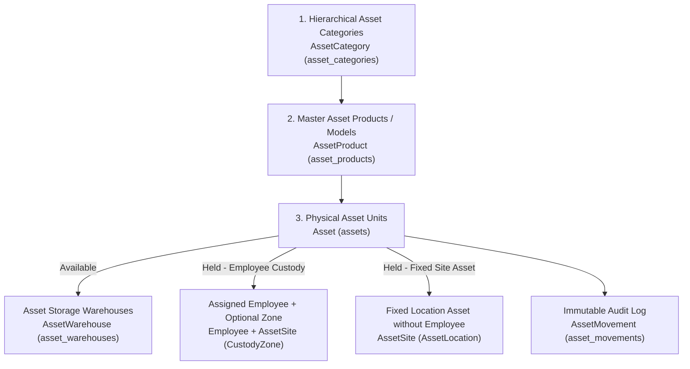

# Assets & Custody Management Plugin (`plugins/webkul/assets`)

A comprehensive plugin for managing enterprise assets, employee custody, and operational site deployments in **AureusERP**. Built strictly to Laravel 13, Filament v5, and Livewire 4 standards, and completely isolated from commercial retail inventory (`products_products` / `inventories`).

---

## 1. Architecture & Core Components Overview

The plugin implements a **3-Tier Normalized Catalog** that decouples standard product models from physical unit instances, with a complete operational separation between **storage warehouses** and **custody sites/zones**:



| Model | Database Table | Operational Role |
| :--- | :--- | :--- |
| [`AssetCategory`](src/Models/AssetCategory.php) | `asset_categories` | Unlimited category tree hierarchy (`parent_id`, `full_name`, `parent_path`) with recursion cycle prevention. |
| [`AssetProduct`](src/Models/AssetProduct.php) | `asset_products` | Master model template (`name`, `model`, `category_id`, `cost`, `is_active`) with an [`AssetProductType`](src/Enums/AssetProductType.php) discriminator: `Asset` for serial-tracked units and `Consumable` for quantity batches issued individually or in groups without return. |
| [`Asset`](src/Models/Asset.php) | `assets` | Physical unit instance (`asset_tag`, `serial_no`, `status`, `condition`, `cost`, `purchase_date`, `warranty_until`) or consumable quantity batch (`initial_quantity`, `quantity`, transitioning to `Consumed` when depleted). |
| [`AssetWarehouse`](src/Models/AssetWarehouse.php) | `asset_warehouses` | Storage depot for available assets (`Available`) with a designated custodian employee (`custodian_employee_id`). |
| [`AssetSite`](src/Models/AssetSite.php) | `asset_sites` | Hierarchical operational location operating in dual modes via [`AssetSiteUsage`](src/Enums/AssetSiteUsage.php):<br/>• **`CustodyZone`:** Associated with an assigned employee.<br/>• **`AssetLocation`:** Assigned directly to the site itself (e.g., conference room, server room) with an optional default custodian (`default_custodian_employee_id`). |
| [`AssetSiteType`](src/Models/AssetSiteType.php) | `asset_site_types` | Configurable site classifications (building, floor, room, vehicle, field station...). |
| [`AssetMovement`](src/Models/AssetMovement.php) | `asset_movements` | Immutable audit log capturing every lifecycle event (`Registered`, `Issued`, `Transferred`, `Returned`, `Scrapped`, `Lost`) with `quantity` tracking. |

---

## 2. Prerequisites, Installation & Testing Commands

### Dependencies
The plugin depends strictly on foundational core packages:
- `support` (companies, sequences, system settings)
- `security` (users, roles, permissions, `PermissionType` scoping)
- `employees` (employees and departments)

### Artisan Commands
```bash
# 1. Install plugin migrations and default settings
php artisan assets:install --no-interaction

# 2. Seed comprehensive demo data (including the 4 standard roles)
php artisan db:seed --class="Webkul\\Asset\\Database\\Seeders\\AssetDemoSeeder" --no-interaction

# 3. Run all plugin feature tests (Pest 4)
php artisan test plugins/webkul/assets/tests --compact

# 4. Code formatting & styling (Laravel Pint)
vendor/bin/pint plugins/webkul/assets --format agent
```

---

## 3. Asset Lifecycle & Operational Rules

All lifecycle transitions are transacted via [`AssetCustodyService`](src/Services/AssetCustodyService.php) inside database transactions with pessimistic locking (`DB::transaction` + `lockForUpdate()`):

| Action | Method in `AssetCustodyService` | State Transition | Architectural Guarantees & Safeguards |
| :--- | :--- | :--- | :--- |
| **Single / Bulk Registration** | `create` / `bulkRegister()` | New $\rightarrow$ `Available` or `Held` | Supports registering up to 200 units in a single batch. Records a `Registered` movement (plus an `Issued` movement if placed directly into custody). |
| **Issue Custody / Deploy to Site** | `issue()` | `Available` $\rightarrow$ `Held` / `Consumed` | For tracked assets, clears `warehouse_id` and assigns an employee (`CustodyZone`) or fixed site (`AssetLocation`). For consumable batches, deducts issued quantities (supporting single or group issuance by employees, departments, or site) and transitions to `Consumed` once `quantity` reaches `0`. |
| **Transfer Custody** | `transfer()` | `Held` $\rightarrow$ `Held` | Transfers an asset between employees or locations. Enforces a no-op guard against transferring to the existing holder and merges return/issue attachments. |
| **Return to Warehouse** | `return()` | `Held` $\rightarrow$ `Available` | Returns the unit to an active warehouse (`warehouse_id`) and clears `current_employee_id`, `current_site_id`, and `expected_return_at`. |
| **Scrap / Write-off** | `scrap()` | `Available / Held` $\rightarrow$ `Scrapped` | Terminal state taking the asset out of service, preserving final holder and warehouse details in the `Scrapped` movement. |
| **Mark as Lost** | `markLost()` | `Available / Held` $\rightarrow$ `Lost` | Terminal state documenting asset loss, logging the last accountable holder in the `Lost` movement. |

### Employee Offboarding Guard ([`EmployeeObserver`](src/Observers/EmployeeObserver.php))
- Prevents deactivating (`is_active = false`) or deleting any employee who holds active personal custody (`status = Held`, `current_employee_id != null`) until the custody is returned or transferred. Being a default site custodian or warehouse custodian does not block employee offboarding (`nullOnDelete`).

---

## 4. Permissions & Role Levels Architecture

The plugin implements the two-layer AureusERP authorization model: **Filament Shield resource abilities** + **Hierarchical user scoping (`PermissionType`: `INDIVIDUAL`, `GROUP`, `GLOBAL`)**.

### 4.1 Action Authorization Mapping
- **Single & Bulk Registration (`BulkRegisterAssetsAction`):** Requires `create_asset_asset`.
- **Issue, Transfer, Return:** Requires `update_asset_asset` plus record ownership scope access.
- **Scrap, Mark Lost:** Requires `delete_asset_asset` (and manager scope `GLOBAL`/`GROUP` if termination approval is enabled in settings).
- **Inline Quick-Create (`+` on Select inputs):** Protected by explicit create policies on target resources (`create_asset_product`, `create_asset_asset::warehouse`, `create_asset_asset::site`, `create_employees_employee`).

### 4.2 Standard Role Matrix

| Role | Scope (`PermissionType`) | Asset (`Asset`) | Warehouses (`Warehouse`) | Sites (`Site`) | Catalog (`Product`) | Settings (`ManageAssets`) | Operational Scope |
| :--- | :--- | :--- | :--- | :--- | :--- | :--- | :--- |
| **1. Custody Officer** | `INDIVIDUAL` / `GROUP` | `view_any`, `view`, `update` | `view_any`, `view` | `view_any`, `view` | `view_any`, `view` | ❌ | Day-to-day custody issue, transfer, and return without asset creation, scrapping, or catalog modifications. |
| **2. Custody Manager** | `GROUP` / `GLOBAL` | `view_any`, `view`, `update`, `delete` | `view_any`, `view` | Full CRUD | `view_any`, `view` | ❌ | Oversees custody across all operational sites, manages site configurations, and authorizes scrap/lost dispositions. |
| **3. Asset Officer** | `GROUP` / `GLOBAL` | `view_any`, `view`, `create`, `update` | `view_any`, `view`, `create`, `update` | `view_any`, `view`, `create`, `update` | `view_any`, `view`, `create`, `update` | ❌ | Maintains master product catalog, performs single and bulk asset registrations, and manages storage warehouses. |
| **4. Asset Manager** | `GLOBAL` | Full CRUD (`+ restore, force_delete`) | Full CRUD | Full CRUD | Full CRUD | ✅ `page_asset_manage_assets` | Complete lifecycle ownership, numbering sequences, structural configurations, terminal write-offs, and settings. |

---

## 5. Settings Reference (`AssetSettings` / `ManageAssets`)

Asset settings are accessible both globally in **System Settings (`Settings -> Assets`)** and within the plugin navigation (**`Assets -> Configurations -> Manage Assets`**):

| Category | Setting Key | Description & Operational Impact |
| :--- | :--- | :--- |
| **Tagging & Registration** | `auto_generate_tag` | Automatically generates sequential asset tags on creation and bulk registration. |
| **Tagging & Registration** | `tag_prefix` & `tag_padding` | Tag prefix (e.g. `AST-`) and zero-padded sequence width (`3` to `8` digits, default `5` $\rightarrow$ `AST-00001`). Locked once assets are registered. |
| **Tagging & Registration** | `default_condition` | Default technical condition for newly registered units (`new`, `good`, `fair`, `poor`, `damaged`). |
| **Tagging & Registration** | `require_serial_by_default` | Enforces mandatory serial numbers (`serial_no`) on single creation and bulk registration. |
| **Warehouses & Operations** | `default_warehouse_id` | Default storage warehouse for newly registered and returned assets. |
| **Warehouses & Operations** | `enable_site_assets` | Toggle fixed site-only asset deployments (`site_asset`). When disabled, simplifies UI into a 1-step employee custody flow. |
| **Custody Rules & Duration** | `require_site_on_custody` | Mandates specifying an operational site (`CustodyZone`) when assigning an asset to an employee. |
| **Custody Rules & Duration** | `default_custody_duration_days` | Default custody duration in days; automatically pre-populates `expected_return_at` during issue and transfer. |
| **Custody Rules & Duration** | `require_expected_return_date` | Mandates specifying an expected return date when issuing custody to employees. |
| **Custody Rules & Duration** | `prevent_duplicate_product_custody` | Prevents issuing a second unit of the same `AssetProduct` to an employee who already holds an active unit. |
| **Consumables Issuance** | `enable_consumables_batch_issue` | Enables issuing a consumable batch to multiple employees at once (including bulk selection by department or site). |
| **Consumables Issuance** | `auto_fill_consumable_employees_by_site` | Automatically populates active site custody holders when selecting a site during consumable issuance. |
| **Consumables Issuance** | `default_consumable_issue_quantity` | Default quantity per recipient pre-filled in the consumable issue modal. |
| **Consumables Issuance** | `require_site_on_consumable_issue` | Mandates specifying an operational site when issuing consumables (independent of `require_site_on_custody`). |
| **Consumables Issuance** | `require_attachments_on_consumable_issue` | Enforces uploading handover documentation when issuing consumables (independent of `require_attachments_on_custody`). |
| **Documentation & Governance** | `require_attachments_on_custody` | Enforces uploading handover/acceptance documentation on issue, transfer, return, and direct custody creation. |
| **Documentation & Governance** | `require_attachments_on_damage` | Enforces uploading photos/inspection reports when an asset condition is marked as `Damaged`. |
| **Documentation & Governance** | `require_attachments_on_termination` | Enforces official loss or scrap write-off reports when executing `Scrap` or `Mark Lost`. |
| **Documentation & Governance** | `restrict_termination_to_managers` & `termination_approval_cost_threshold` | Restricts terminal dispositions (`Scrap` / `Lost`) — or dispositions exceeding the specified acquisition cost threshold — to managers (`PermissionType::GLOBAL` or `GROUP`). |
